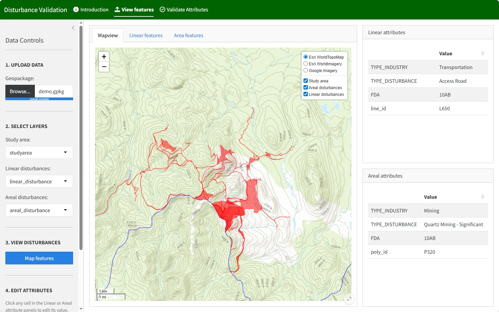

## Disturbance Validation

September 9, 2026

The Disturbance Validation app is a Shiny app that enables users to i) interactively examine linear and areal surface disturbance features along with high resolution ESRI and Google satellite imagery, ii) edit linear and areal disturbance attribute values if needed, iii) validate industry and disturbance type attribute values, and iv) detect and remove exact-duplicate or partially overlapping features. This permits users or reviewers to quickly look at the digitized features and their assigned attributes, ensure that only permitted values are used for disturbance types, and edit them if necessary.

The app is organized into three tabs:

  - **View features** - upload a GeoPackage, map the study area and the linear and areal disturbances over satellite imagery, select features on the map or in the attribute tables, and edit attribute values.
  - **Validate attributes** - upload a CSV of permitted values and flag any linear or areal features whose TYPE_INDUSTRY, TYPE_DISTURBANCE, or their combination is not an accepted value.
  - **Fix overlaps** - reusing the GeoPackage already uploaded, pick a layer and detect exact duplicates and partial overlaps, then remove the extra features (keeping one per overlap cluster) and download a cleaned GeoPackage.

The easiest way to run the app is to go to:

- https://beaconsproject.shinyapps.io/disturbance_validation/

